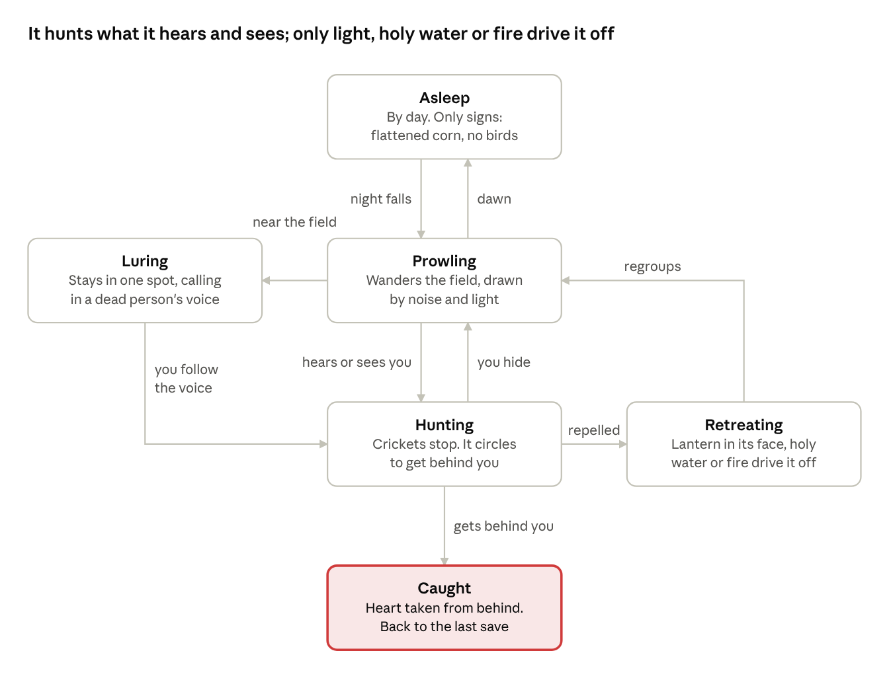
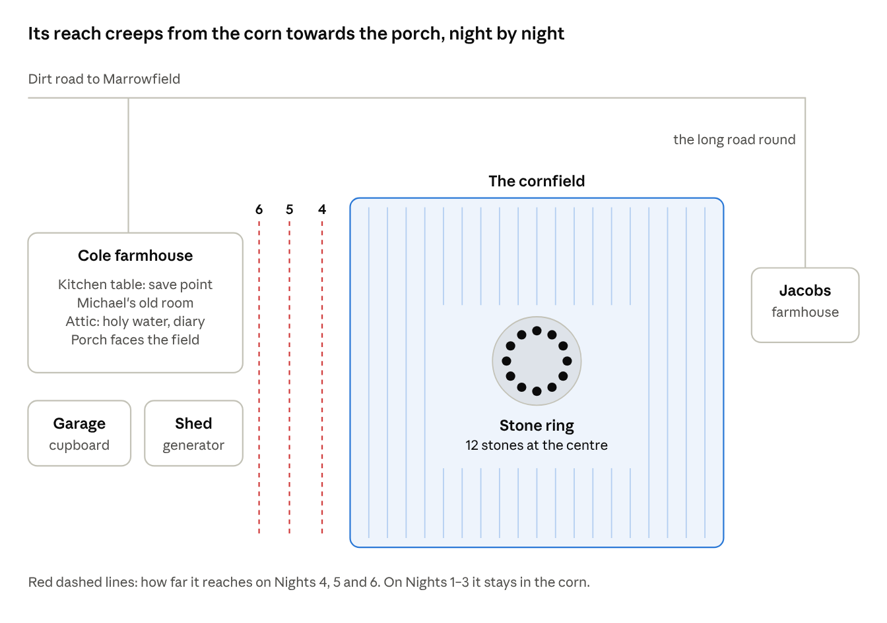

# Stay Away from the Cornfield — Game Design

Oct 28, 2026 · @David Braz

A top-down, pixel-art survival horror game for Android phones, built from your 2002 story and the characters and rules in the [novel plan](https://claude.ai/artifact/8bQeC7LiugYcJZRC53d43v), moved to a fictional farming town so it feels universal. It is written so you can hand it to Claude Code one section at a time.

## At a glance

You survive seven nights on a corn farm outside Marrowfield, a fictional farming town, while something in the field learns your family's voices. Players learn two rules in the first five minutes, and the whole game is built on them: **when the crickets stop, it is close**, and **a voice that does not move is not who it says it is**.

| Element    | Plan                                                                                                                                     |
|------------|------------------------------------------------------------------------------------------------------------------------------------------|
| Genre      | Survival horror: you hide, listen and run. You only fight back in the finale                                                             |
| Platform   | Android phones, played in landscape with two thumbs                                                                                      |
| Look       | Top-down pixel art in the style of *Stardew Valley*: 16 × 16-pixel tiles, a dusty farmland palette by day, lantern-lit darkness by night |
| Player     | Michael Cole, plus three short doomed scenes: Hendrik Jacobs in the prologue, then Jason, then Jenny                                     |
| Length     | Target 2–3 hours: a prologue, seven days and nights, and a finale. Each chapter takes 10–20 minutes, about one phone session             |
| Setting    | Marrowfield, a fictional farming town in no named country, in the early 2000s: before smartphones, so help is hard to call               |
| Age rating | Expect a high rating: blood, decapitation (in pixel art and mostly off-screen), occult themes and strong language                        |
| Price      | Open question: a free demo (prologue and Day 1) with a paid full game, or paid upfront                                                   |

## Look and phones

Your instinct is right: a 2D top-down game in the *Stardew Valley* style is the better choice for phones. It runs on cheap handsets, stays cool, and suits horror better than you might expect.

**Why it runs cooler than 3D**

- A phone heats up when its processor and graphics chip work hard, and when it gets too hot it slows itself down to cool off ([Android Developers](https://developer.android.com/games/optimize/power)). 3D asks the graphics chip to light and shade every surface every frame. A 2D pixel game mostly places flat pictures.

- The game draws a small picture, about 480 × 270 pixels, and the phone enlarges it with crisp, blocky pixels. That is very little work per frame.

- It runs at 30 frames a second. Android's own guidance notes that refreshing faster than a game's frame rate only costs power, and a slow, creeping horror game loses nothing at 30.

- Night is a dark layer with holes cut out for lamplight, not real lighting. It looks atmospheric and costs almost nothing.

**Why top-down suits horror**

- You only see a small circle of lantern light, and the corn hides anything more than a tile or two away. Dread comes from what you cannot see.

- Sound does most of the frightening: wind in the stalks, crickets, a dog, a voice. The game asks for headphones on its first screen.

- *Darkwood* (2017) proved that top-down survival horror works; it is a good reference for the feel.

**Art direction**

- Tiles of 16 × 16 pixels; people 16 × 32. By day: ochre dust, faded green corn, the red tin roof gone to rust. By night: blue-black, with amber lamplight.

- The thing in the field is larger than everyone else and mostly seen as two red eyes and a silhouette until the finale.

- Art is the biggest job in the project. Claude Code can make rough placeholder art so the game can be built and tested, but the finished look needs either ready-made pixel-art packs, adapted, or a pixel artist (see Decisions).

**What to build it in**

| Option                     | How you test it                                                                    | Getting it onto Google Play                                                                                                                                                                 | Fit for you                                                                  |
|----------------------------|------------------------------------------------------------------------------------|---------------------------------------------------------------------------------------------------------------------------------------------------------------------------------------------|------------------------------------------------------------------------------|
| **Phaser 4** (recommended) | Opens in your phone's browser from a link, so every change can be tried in seconds | Wrapped as an Android app with [Capacitor](https://capacitorjs.com/docs/android), which supports Android 7 and later, about 99% of phones. That one step needs Android Studio on a computer | The same web approach Claude Code already used; nothing to install to start  |
| **Godot 4**                | Needs the Godot editor on a computer, then an export to the phone                  | Exports Android apps directly                                                                                                                                                               | A stronger engine for big games, but more setup for someone who doesn't code |

[Phaser](https://phaser.io/download/phaser4) is a free JavaScript framework for 2D browser games; its latest release is v4.2.1, from 9 July 2026. The 3D prototype you already have would be rebuilt from scratch, which is normal for a first prototype.

## How it plays

Michael never gets a gun. He survives by light, silence and hiding, and by learning to tell a real voice from a lure.

**Touch controls (landscape, two thumbs)**

| Control  | Where                                                              | What it does                                  |
|----------|--------------------------------------------------------------------|-----------------------------------------------|
| Move     | Left thumb, anywhere on the left half; a joystick appears under it | Walk; push to the edge to run                 |
| Act      | Right thumb, one large button                                      | Open, pick up, talk, hide, read               |
| Lantern  | Small button above Act                                             | On or off                                     |
| Notebook | Top-right corner                                                   | Objectives, clues, the map and the stone ring |

**Light**

- At night Michael carries an oil lantern. Lamp oil is limited and has to be found around the farm.

- Lantern on, you see about five tiles, but the thing can see you from much further away. Lantern off, you see one or two tiles by moonlight.

**Noise**

- Walking along a row of corn is quiet. Pushing across the rows is slow and loud, because the stalks crack. Running is loud everywhere.

- A faint ring flashes around Michael whenever he makes noise, so players learn what carries.

**Listening: the two rules**

- **The crickets.** The night is full of crickets until the thing comes near; then they stop. For players who cannot hear well, a small cricket icon in the corner fades with the sound.

- **The lure.** Voices from the field appear as speech bubbles with a direction marker. A real person's voice moves; the lure's stays in one fixed spot and repeats itself word for word, just as in the prologue. From Night 6 it learns to move its voice, but it still repeats itself.

**Hiding**

- Wardrobes, under beds, the pantry, the cab of the old pickup truck. While it passes, hold Act to hold your breath, which drains a small breath meter.

- In the field, stop moving and put the lantern out. Unless it is within two tiles, it loses you.

**Fear instead of health**

- There is no health bar. If it catches you from behind, you die: the signature kill, shown as a cut to black and a heartbeat that stops.

- As it gets closer, Michael's heartbeat rises in your headphones and the phone vibrates in time with it.

**Tools, few and late**

- Holy water (from Day 5): a splash drives it back for a few seconds. There are only a few vials.

- Matches and petrol: fire frightens it. These are mostly for the finale.

- His mother's rosary: in the finale, you hold it to pray.

**Saving**

- The game saves at the start of every day and night, and whenever Michael sits at the kitchen table with Jenny's old Snakes and Ladders board.

- Phone calls and app switches interrupt play, so it also saves the moment the game goes into the background.

**Michael's notebook**

- He is a writer, so the quest log is his notebook: objectives as notes, clues as pasted-in scraps, a sketch map, and the stone ring, with a stone crossed out each time one is torn up.

- Between chapters, a page of the novel he is secretly writing appears: the book he will one day publish.

## The thing in the field

The story's rules become the creature's behaviour, so players can learn it and predict it, and still get caught. It never attacks from the front: keep it in your lantern light and it hesitates, so it circles to get behind you.

| Rule                                | In the story                                                                                 | In the game                                                                                                                                                                                                               |
|-------------------------------------|----------------------------------------------------------------------------------------------|---------------------------------------------------------------------------------------------------------------------------------------------------------------------------------------------------------------------------|
| It cannot leave the field           | The corn is its boundary                                                                     | The field is its hunting ground. Each night its reach creeps outward: the field only, then the lawn, the yard, and finally the porch. Grass withers along the edge of its reach, so you can see the line by lantern light |
| It wears its dead                   | It takes the shape and voice of anything it has killed                                       | The lure. It calls to you in the voices of its victims. The tells: the voice stays in one spot and repeats itself word for word                                                                                           |
| The signature kill                  | The heart from behind, then the hook, then the pentagram                                     | Caught from behind means death. Facing it with the lantern makes it hold back                                                                                                                                             |
| The stones are its cage             | A ring of carved stones at the centre of the field, loosened by the floods                   | The ticking clock. The ring has twelve stones, and it tears out at least one each night. Every lost stone widens its reach, and the notebook keeps count                                                                  |
| The books bind souls                | Each member of the Circle signed a black book; destroying one wounds it but kills the signer | The story objective: find both books. Destroying Mr Jacobs's book proves the method works; the last one is Walter's                                                                                                       |
| Holy water, fire and prayer hurt it | Planted through Michael's mother and through Jean                                            | The tools: holy water stuns it, fire drives it off, and prayer finishes it in the finale                                                                                                                                  |

the creature's behaviour · 6 states

Every change of state has a cue the player can learn: silence means it is hunting, and a voice that stays put means it is luring.

## The script

The game follows your story beat for beat, stretched across seven days and nights. Days are for exploring, talking and finding clues; nights are for surviving. Names that sounded South African in the novel plan have neutral versions here (see Decisions).

### Prologue: Come see

*Play as Henry Jacobs, the neighbour. About 6 minutes. Teaches movement, the lantern and the two rules.*

- The Jacobs kitchen after three days of rain. Justin and Phillip argue over Snakes and Ladders ("You threw a three!"). A carved stone the housekeeper found sits on the counter; examining it gives "Someone carved this a long time ago."

- Henry dozes in front of the TV and the screen fades. He wakes to silence and the back door open.

- Follow the boys' laughter into the corn. The player learns that rows are quiet and crossing them is loud.

- The crickets stop. A speech bubble that never moves: *"Grandpa. Come see."* It says it again, word for word.

- Something strikes his back and rolls into the dark. Henry's reaction tells the player what it was.

- The screen shakes. In front of him, a black hand holds something red that is still beating. Cut to black, then the title: **STAY AWAY FROM THE CORNFIELD**.

### Day 1 and Night 1: Homecoming

*Play as Michael from here on.*

- **Day:** A cutscene of the red car on the dirt road as a police car speeds past. Then Jenny, his father Walter, and the house: his mother's photo ("A farm accident, Pa said."), his old room, the rosary in a drawer. He hears the news: Mr Jacobs and both his grandsons were killed last night.

- Jason and Jean arrive in a white Beetle. At dinner Walter sets the rule: *"Nobody goes into the corn. Not until the police are done."*

- **Night:** Walter asks Michael to lock up: close every window and door, then check the generator in the shed. Spike growls at the corn. Once, briefly, the crickets stop. Nothing attacks, because tonight its reach ends at the corn.

### Day 2 and Night 2: Spike

- **Day:** Detective Anna Venn interviews the family and notices Michael is already writing about the murders.

- Walk the long road round to the Jacobs farm. There is tape on the door and the Snakes and Ladders board is still laid out. Ruth Hale, the housekeeper, sits on the porch: *"Stay away from the cornfield, Mr Cole. Those old men used to go in there at night. Years ago. I saw the lanterns."*

- Back home, Spike barks at the field and bolts. Chase him through the corn in daylight, the first real stretch of the maze. You find him dead at the centre, beside a ring of half-buried carved stones.

- **Night (play as Jason):** A short, doomed scene. Spike barks under the window from one spot that never moves. Jason goes out. Inside the corn he is lost, the crickets stop, and that is the end of him.

### Day 3 and Night 3: Jenny, come here

- **Day:** Jason is missing. Search the field by day with Jenny and find his torch. A crow strikes her head. The police find nothing.

- Jean finds an engagement ring in Jason's bag. She and Michael talk properly for the first time; she is a nurse, and she reads the signs better than he does.

- At supper a carved stone smashes through the kitchen window. Walter pockets it: *"It's nothing."* The notebook shows its carvings match the ring in the field.

- **Night:** Jason's voice calls Jenny from the corn. She sees him in the first row, holding his own head. Chase her across the lawn and catch her before she reaches the corn; if she gets in, you start the chase again. Michael tells her: *"You were dreaming."*

- **Interlude (play as Jenny):** Later she slips out alone. Jason stands whole and smiling. She holds him, and his eyes turn red.

### Day 4 and Night 4: On the lawn

- **Day:** At dawn Jean screams. Jason and Jenny lie on the lawn, outside the field, so its reach has grown. The police take Michael in. Detective Venn reads his notebook aloud, and you answer her questions in dialogue choices. He is released at dusk, and Walter drives him home in silence.

- **Night:** The power fails. Cross the lawn and yard to the generator shed with its reach now at the edge of the lawn. You can see the withered grass, Spike's bark comes from the corn, and the lamp oil is running low. This is the first real stealth night.

### Day 5 and Night 5: The cupboard

- **Day:** A funeral in Marrowfield. After it, Ruth hands Michael Henry's parcel: a black book and a letter reading *"If I die, burn it. Walter knows how."*

- Walter drives Jean to the bus. Alone, Michael finds the old key hidden in his father's room and opens the locked cupboard in the garage: a black robe, more stones, and a photograph of Walter and Henry with other robed men around a goat's head on a pole.

- **Confrontation:** a dialogue scene. Walter admits the Circle, the scroll and the summoning, but lies about Michael's mother.

- **Night:** Jean comes back; she couldn't get on the bus. In the attic they find his mother's barrel of holy water and her diary, which explains the stones and the books. Michael dunks Henry's book in the holy water, and the whole field screams.

- It takes its revenge, tearing out three stones at once. Detective Venn arrives alone in the dark. Michael can flash the lantern at her from the window, but she doesn't understand, and she dies at the edge of the yard.

### Day 6 and Night 6: Faces at the window

- **Day:** A second storm floods the road and cuts the power and phone lines. Walter tells the whole truth: the Circle's victims were farmhands and drifters nobody came looking for, Ruth's brother among them, and the thing killed Michael's mother when she found out. You choose whether Michael forgives him.

- Prepare for the siege: board the windows, gather lamp oil, fill vials of holy water.

- **Night:** Its reach is at the porch. It wears Jenny at the glass, then Michael's mother: *"Michael. Come see."* Its voice moves now, but it still repeats itself. Keep the lamps lit, keep Jean from the windows, and hide when it tries the doors.

- Near dawn Walter walks to the edge of the field with his shotgun. *"Time to join the master."* One shot. With Walter dead, his book can be destroyed without killing anyone.

### Day 7 and the finale: Come and get me

- **Day:** Gather holy water, petrol from the shed, matches, the crucifix and the rosary. Dunk Walter's book, and the field screams again.

- **Finale:** Into the corn with Jean at nightfall. Get her to the ring at the centre while it hunts you, wearing Walter, then Jenny, then its own face. Keep your lantern on it and never let it behind you.

- At the ring: pour the petrol, light the book, set down the crucifix, and pray. Holding the rosary, you hold the button through each line of the Our Father while it circles. Let go to turn and face it; let it behind you and it is over.

- The book bleeds and crumbles. Its skin peels away, the ground opens, and it is gone.

### Endings

| Ending                           | How you get it                                                                                                         | What you see                                                                                                                                                             |
|----------------------------------|------------------------------------------------------------------------------------------------------------------------|--------------------------------------------------------------------------------------------------------------------------------------------------------------------------|
| **Dawn**                         | Finish the finale with Jean alive                                                                                      | Michael and Jean walk out of the corn at sunrise. A year later, an interviewer asks what inspired his new novel. *"Just a visit to my father's farm."* If only they knew |
| **Alone**                        | Jean is caught during the finale                                                                                       | The same interview, but Michael is alone, and the last shot lingers on the empty chair                                                                                   |
| **Remembered** (the true ending) | Find the names of all twelve of the Circle's victims, hidden in photos, the diary, Henry's letter and the town records | After the interview, Ruth reads the names aloud, her brother's last. The victims are no longer forgotten                                                                 |

Every ending closes on the same sting: a new farmer ploughs the field and turns up a carved stone.

## Building it with Claude Code

Build it in small playable slices and test each one on your phone. Get the prologue right before anything else: if the first six minutes frighten people, the rest will follow.

**Milestones, in order**

1.  **Grey-box prologue.** A Phaser 4 project with coloured squares for art: the joystick, Act and lantern buttons, a cornfield in rows, crickets that stop, the voice bubble that never moves, and the kill. *Done when* someone plays it with headphones and jumps.

2.  **The creature's brain.** Its states (see the drawing above), plus noise, light, facing and the reach line. *Done when* it hunts you differently depending on how loud and bright you are.

3.  **Placeholder art and sound.** 16 × 16 tiles, simple sprites, wind, crickets, the heartbeat and phone vibration.

4.  **The farm and its systems.** The house, yard, shed, garage and attic; dialogue; the notebook; saving, including when the app goes into the background.

5.  **Days 1–3,** including the Jason and Jenny scenes and the chase across the lawn.

6.  **Days 4–7 and the finale,** including the siege night, the ritual and all three endings.

7.  **Final art and audio,** from asset packs or an artist.

8.  **The Android app.** Wrap it with Capacitor, add the icon and splash screen, and test on a cheap phone and a good one. Play for 30 minutes and check that the phone stays cool.

9.  **Google Play** (below).

**Working with Claude Code**

- Give it one milestone at a time, and paste in the sections of this doc that milestone needs.

- Ask it to keep a README in the project that records what is built and how to run it, so a fresh session can pick up where the last one stopped.

- Ask it to put every build online at a free link you can open on your phone; GitHub Pages is one option.

**Getting onto Google Play**

- A developer account costs a one-time US\$25 and needs identity verification ([Google](https://support.google.com/googleplay/android-developer/answer/6112435?hl=en)).

- A personal account created after 13 November 2023 must run a closed test with at least 12 testers, opted in for 14 consecutive days, before it can publish to everyone ([Google](https://support.google.com/googleplay/android-developer/answer/14151465?hl=en)). Recruit adults, such as friends and colleagues; with this rating, learners should not be testers.

- Every app needs an age rating from the IARC questionnaire in Play Console. Answer it honestly about the blood and occult content, because misrepresentation can get the game removed ([Google](https://support.google.com/googleplay/android-developer/answer/9898843)).

## The map

The Cole house has its back to the field, and the only safe way to the Jacobs farm is the long road round. Everything happens in five places: the house, the yard buildings, the field, the stone ring and the Jacobs farmhouse, plus a short visit to Marrowfield for the funeral.

the farm · a sketch, not to scale

## Decisions for David

Tick these off or comment with your answers, and the first milestone can go to Claude Code.

- [x] **Town name:** Marrowfield

- [x] **Neutral names:** Henry Jacobs, Ruth Hale (the housekeeper), Detective Anna Venn, and the Circle as the cult.

- [x] **Engine:** Phaser 4 or Godot 4? *Suggestion: Phaser 4, because you can test every change on your phone from a link.*

- [x] **Final art:** ready-made pixel-art packs, adapted, or a pixel artist? *Suggestion: packs first; an artist later if the game proves itself.*

- [x] **Price:** a free demo (prologue and Day 1) with a paid full game, or paid upfront?

- [x] **On-screen violence:** pixel blood, with every kill cutting to black as written, or more shown? *Suggestion: as written; what players imagine is worse.*

- [x] **The doomed scenes** as Henry, Jason and Jenny: playable, or cutscenes? *Suggestion: playable and short; they are where the dread lives.*

- [x] **The novel:** set it aside for now

## Sources

- [Optimize power efficiency](https://developer.android.com/games/optimize/power), Android Developers

- [Capacitor Android documentation](https://capacitorjs.com/docs/android), Capacitor

- [Download Phaser 4](https://phaser.io/download/phaser4), Phaser

- [Play Console registration and identity verification](https://support.google.com/googleplay/android-developer/answer/6112435?hl=en), Google Play Console Help

- [App testing requirements for new personal developer accounts](https://support.google.com/googleplay/android-developer/answer/14151465?hl=en), Google Play Console Help

- [Content ratings](https://support.google.com/googleplay/android-developer/answer/9898843), Google Play Console Help
